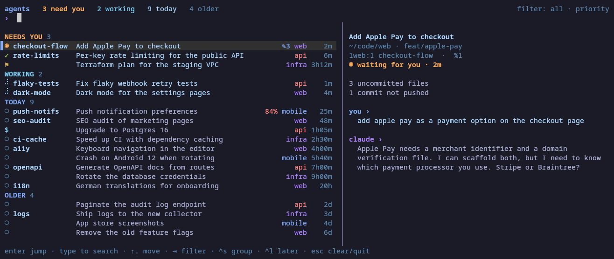

# tmux-ai-navigator

A picker for the AI coding agents running in your tmux panes. It's like
[herdr](https://herdr.dev)'s agent list, but for tmux. It shows every
[Claude Code](https://claude.com/claude-code) and [Codex CLI](https://github.com/openai/codex)
session in every tmux session and window,
grouped by what needs you: sessions **waiting** for an answer, ones that **finished since
you last looked**, and ones you flagged for **later**. Then come sessions that are working,
active today, and older ones. Sessions you **pin** stay above all of that until you unpin them. A preview shows each session's last prompt and reply. You can
search the list and press Enter to jump to that pane.



Try it without any sessions of your own: `bin/tmux-ai-nav demo`.

## Requirements

- Linux or macOS.
- tmux 3.0 or newer. On tmux 3.2+ the picker opens in a popup; on 3.0 and 3.1 it opens in
  a temporary window.
- Python 3.8 or newer, standard library only.
- Claude Code and/or Codex CLI. Claude Code writes a status file for each running session in
  `~/.claude/sessions/`; Codex sessions are found from the panes they run in (see
  [Codex](#codex)). Nothing to install or configure for either.

## Install

With [TPM](https://github.com/tmux-plugins/tpm), add the plugin next to your other
`@plugin` lines, then press `prefix I` to install it:

```tmux
set -g @plugin 'ferrants/tmux-ai-navigator'
```

Manually:

```sh
git clone https://github.com/ferrants/tmux-ai-navigator ~/.tmux/plugins/tmux-ai-navigator
```

```tmux
# ~/.tmux.conf
run-shell ~/.tmux/plugins/tmux-ai-navigator/tmux-ai-navigator.tmux
```

Then reload the config with `tmux source ~/.tmux.conf`. The paths here assume TPM's default
plugin folder; if you've set `TMUX_PLUGIN_MANAGER_PATH` (e.g. `~/.config/tmux/plugins/`),
use that instead.

Updating: `prefix U` with TPM, or `git pull` and reload the config. Reloading also restarts
the notification watcher on the new version.

### Options

Set options anywhere above the line that loads plugins: `run '~/.tmux/plugins/tpm/tpm'`
with TPM, or the `run-shell` line for a manual install.

```tmux
set -g @ainav-key 'a'                # prefix key that opens/closes the picker (default a)
set -g @ainav-later-key 'u'          # prefix key: flag the current pane's session for later (default u)
set -g @ainav-last-key 'A'           # prefix key: back to the agent you were on before (default A)
set -g @ainav-pin-key 'P'            # prefix key: pin the current pane's session to the top (default P)
set -g @ainav-popup 'on'             # tmux 3.2+: popup (on) or temporary window (off)
set -g @ainav-popup-width '90%'
set -g @ainav-popup-height '85%'
set -g @ainav-extras 'command'       # extras command, see below (default none)
set -g @ainav-extras-interval '5'    # seconds between extras runs (default 5)
set -g @ainav-notify 'tmux'          # notifications, see below (default tmux)
set -g @ainav-default-tab 'all'      # tab to open on: all, session or project (default all)
set -g @ainav-resume '10'            # minutes the "↺ back" view is offered after a jump; 0 = off
```

The plugin doesn't take a key that's already bound. Many configs use `prefix a` for
`send-prefix`, for example, and URL plugins often use `prefix u`. If a default key is taken,
the plugin skips it and says so in the status line; set `@ainav-key` or `@ainav-later-key`
to choose a key (`@ainav-last-key` for `prefix A`, `@ainav-pin-key` for `prefix P`). A key you set explicitly is always bound.

## Use

`prefix a` opens the picker. `esc` closes it (in the window version, so does pressing
`prefix a` again).

Each row shows the tmux window name, the session's title, the project (the tmux session name
without a leading number, e.g. `2api` → `api`), and how long it has been in its current state.
Codex sessions are marked `cx`.

| icon | |
|---|---|
| ◉ | waiting for you (a question or permission prompt) |
| ✓ | finished since you last looked at its pane |
| ⚑ | flagged for later |
| ⠋ | working |
| $ | a background shell is running |
| ○ | idle |

| key | |
|---|---|
| type | search window name, title, project, path, branch, status, extras and the preview's last prompt and reply (all words must match; ignores case unless the search has a capital; matches are highlighted in the preview) |
| ↑ ↓ / ctrl-p ctrl-n, PgUp PgDn | move |
| enter | jump to that agent's pane (or expand "older") |
| tab / shift-tab | next / previous tab (see below) |
| ctrl-s | group: priority sections, or by project |
| ctrl-l | flag or unflag the selected session for later |
| ctrl-t | pin or unpin the selected session |
| ctrl-u / ctrl-w | clear the search / delete the last word |
| esc | clear the search, or quit if it's empty |

`prefix u` flags the session in the current pane for later without opening the picker. A
flag clears once you prompt that session again.

Pins are for the sessions you want to keep in mind. A pinned session sits in a PINNED section
at the top (in every tab, and above the project groups with `ctrl-s`), most recently active
first, and stays there after you reply. Its row still shows whether it's waiting, done or
working, and it still counts in "need you". `ctrl-t` pins in the picker, `prefix P` pins the
session in the current pane; press again to unpin. Pins belong to the Claude or Codex
session, so they survive a tmux restart and come back when you resume the session.

`prefix A` jumps back to the agent you were on before, across tmux sessions and windows, and
pressing it again bounces between the two, like `cd -`. Only agent panes count, so a shell you
looked at in between is skipped. Each terminal (tmux client) has its own history; in the
picker, that agent is marked `↩`. tmux's own `prefix l` and `prefix L` still work, but they
remember the last window and the last session separately.

### Tabs

The tabs across the top narrow the list to where you opened the picker from:

- **all**: every agent.
- **the tmux session** (shown by name, e.g. `web`): agents with a pane in that session.
- **the project** (e.g. `~/code/api`): agents whose folder is in the same git repo as the
  pane you opened from (or the same folder, outside git). This includes a project spread over
  several tmux sessions. `ctrl-s` grouping is different: it groups by tmux session name.

Each tab keeps its own search and cursor while the picker is open.

**↺ back** appears first when you jumped from the picker in the last 10 minutes
(`@ainav-resume`) from a view you'd set up: a search, a session or project tab, "older"
expanded, or grouping by project. It's the view you left: the same tab (still the session or project it showed
then, even if you've moved), search, grouping and expanded "older", with the cursor on the row
after the one you opened. The picker opens on it, so going through old sessions one by one is
`prefix a`, `enter`, repeat. `tab` leaves it for a fresh view, `shift-tab` goes back. The view is
kept in the state file with the seen times, one per tmux server.

The list refreshes every second. On wide terminals the preview sits on the right; on
narrow ones it goes underneath. Replies are shown with their markdown formatting: tables
(cells wrap to fit; too many columns become "header: value" lines), lists, headings, bold,
code and quotes.

Colors follow Tokyo Night on 256-color terminals. Inside tmux, a plain `screen`/`tmux`
TERM is upgraded to its `-256color` variant for the picker, and tmux maps colors down for
clients that can't show them. On 8-color terminals it falls back to the basic ANSI colors.

From scripts: `tmux-ai-nav list [--json] [--all]`.

## Codex

Codex sessions show up next to Claude's, with the same sections, preview, "done" tracking,
later flags and notifications. Every `codex` TUI running in a tmux pane is listed (`codex exec`,
`codex review` and Codex's background app-server are not).

Codex runs the conversations of all its TUIs in one shared background process, so the pane a
conversation belongs to can't be learned from its hooks or its process. Instead:

- **Status** comes from the pane title, which the Codex TUI keeps current: a spinner while it
  works, `[ ! ] Action Required` while it waits for an approval, the plain name when idle. If you
  change Codex's `tui.terminal_title` setting, Codex sessions show as idle.
- **The conversation** (its name, when the last turn started or finished, the last prompt and
  reply) comes from Codex's thread database (`$CODEX_HOME/state_*.sqlite`, read-only) and the
  conversation log. A pane is matched to its conversation by the name in its title, by
  `codex resume <id>`, or else by folder and start time. A TUI that hasn't been prompted yet
  has no conversation and is listed as idle.

## Notifications

A small background watcher tells you when a session finishes or starts waiting for you,
unless its pane is already on screen. It only notifies if the session is still in that
state a moment later, so quick back-and-forth doesn't spam you.

```tmux
set -g @ainav-notify 'tmux,system'   # any of: tmux, system, terminal, bell; or off
set -g @ainav-notify-sound 'soft'    # soft (a quiet chime), system, off, or a sound file
set -g @ainav-notify-volume '60'     # 0-100
```

`tmux-ai-nav watch --test done` (or `waiting`) sends a sample notification with your current
settings, so you can try sounds and volumes.

| option | default | |
|---|---|---|
| `@ainav-notify` | `tmux` | `tmux`: a message in the status line. `system`: a desktop notification (`notify-send` on Linux; `terminal-notifier` or `osascript` on macOS). `terminal`: asks your terminal for a desktop notification (OSC 777; works over SSH in terminals that support it, such as kitty, WezTerm, foot and Ghostty). `bell`: rings the terminal bell. `off`: no watcher. |
| `@ainav-notify-on` | `done,waiting` | which events to notify about |
| `@ainav-notify-sound` | `off` | `soft` (or `on`): a short, quiet two-note chime, generated on first use. `system`: your desktop's sound theme (freedesktop `complete`/`message-new-instant` on Linux, Glass/Ping on macOS). Or the path to a sound file. Played with `afplay`, `paplay`, `pw-play`, `ffplay` or `aplay`, whichever is found first. |
| `@ainav-notify-sound-done`, `@ainav-notify-sound-waiting` | | per event: `soft`, `system` or a file |
| `@ainav-notify-volume` | `100` | 0-100 (`aplay` can't change the volume of a file; the soft chime is made at this volume) |
| `@ainav-notify-delay` | `1` | seconds the new state must hold |
| `@ainav-notify-visible` | `off` | `on` also notifies for panes that are on screen |
| `@ainav-notify-command` | | a command to run as well, with `AINAV_EVENT` (`done` or `waiting`), `AINAV_TITLE`, `AINAV_PROJECT`, `AINAV_WINDOW`, `AINAV_PANE`, `AINAV_TMUX_SESSION`, `AINAV_SESSION_ID`, `AINAV_CWD` and `AINAV_MESSAGE` set |

Options are re-read every few seconds. Turning `@ainav-notify` on or off takes effect when
the plugin is loaded again (`tmux source ~/.tmux.conf`), which also restarts the watcher.
There is one watcher per tmux server. It exits with the server and re-reads only the session
files that changed, so it costs next to nothing while idle.

For example, a phone push through [ntfy](https://ntfy.sh):

```tmux
set -g @ainav-notify-command 'curl -s -d "$AINAV_MESSAGE" ntfy.sh/my-agents'
```

## Extras

An extras command adds your own information to the picker: a short badge on the row, a
title for sessions Claude hasn't titled well, lines in the preview, and extra search text.
Use it for whatever you track per session: notes, ticket numbers, git state, context usage.

```tmux
set -g @ainav-extras 'python3 ~/.tmux/plugins/tmux-ai-navigator/examples/git-status-extras.py'
```

The command gets the sessions as JSON on stdin:

```json
{"sessions": [{"session_id": "…", "pid": 4121, "cwd": "/home/me/code/api", "status": "idle",
               "pane_id": "%3", "tmux_session": "2api", "window_name": "rate-limits",
               "agent": "claude"}]}
```

and prints a JSON object keyed by session id. Every field is optional, and sessions can be
left out:

```json
{"<session_id>": {
    "badge": "✎3",
    "badge_style": "info",
    "title": "Per-key rate limiting",
    "lines": ["3 uncommitted files", "1 commit not pushed"],
    "search": "dirty"
}}
```

| field | |
|---|---|
| `badge` | up to 8 characters, shown before the project tag |
| `badge_style` | `warn` (red), `info` (accent) or `dim` (default) |
| `title` | used when Claude's own title is missing or is just an id or the repo name |
| `lines` | shown in the preview under the status line |
| `search` | extra text that search matches |

It runs at most every `@ainav-extras-interval` seconds, and right away when new sessions
appear, with a 3 second timeout. If it fails, the picker shows the error in its footer and
carries on. [`examples/git-status-extras.py`](examples/git-status-extras.py) is a complete
example. You can also pass `--extras 'command'` to `tmux-ai-nav`.

## How it works

- **Sessions.** Each `~/.claude/sessions/<pid>.json` holds the session id, name, working
  directory, status (`busy`, `idle`, `waiting`, `shell`) and when that status last
  changed. Files are left behind when Claude exits, so an entry only counts if its process
  is still running with the same start time (`/proc` on Linux, `ps` on macOS).
- **Finding the pane.** Each agent is matched to its pane by walking up its parent
  processes until one is a pane's shell (`#{pane_pid}`). The pane recorded in the session
  file goes stale when panes are moved, so it isn't used.
- **Jumping.** One `switch-client -c <client> -t '$session:@window.%pane'` switches the
  client that pressed the key to that session, window and pane. Naming the session handles
  windows linked into several sessions.
- **Notifications.** `tmux-ai-nav watch` polls the session files twice a second and only
  looks at panes and titles when a session's status actually changes. While Codex TUIs are
  running, it also reads pane titles once a second (one tmux call).
- **Done.** tmux hooks (`after-select-window`, `after-select-pane`, `client-session-changed`, …)
  run `tmux-ai-nav seen`, which records the panes on screen and the panes that just left it.
  A session is "done" when it went idle after real work, later than its pane was last seen.
  That state lives in `~/.local/state/tmux-ai-navigator/` and resets when the tmux server
  restarts. "Later" flags clear once the session's status changes after you flagged it,
  meaning you've prompted it again.
- **Titles and preview.** Claude's pane title is used first. When that title is just an id
  or the repo name, the latest title in the conversation log is used instead (offsets are
  cached in `~/.cache/tmux-ai-navigator/`). The preview reads only the end of the conversation
  log, and only for the selected row.

## Limitations

- The session files and conversation logs are Claude Code internals, not a documented
  interface. A Claude Code update can change them. Fields that are missing or have changed
  are skipped rather than crashing the picker, but sessions may stop showing up until this
  tool catches up.
- Closing a terminal window without detaching doesn't run tmux's detach hook, so a session
  that finishes while that window is gone may not show as done.
- Claude Code and Codex CLI only. Claude sessions that aren't inside tmux show up in
  `list --all` only; Codex sessions outside tmux aren't listed (their status comes from the
  pane).
- Matching a Codex pane to its conversation is a best guess when the title has no name (older
  Codex versions) and several Codex TUIs share a folder: two of them may swap previews.

## Uninstall

Remove the plugin line from `~/.tmux.conf`, then:

```sh
~/.tmux/plugins/tmux-ai-navigator/bin/tmux-ai-nav watch --stop   # the notification watcher
for h in after-select-pane after-select-window session-window-changed client-session-changed \
         client-attached client-detached; do tmux set-hook -gu "$h[87]"; done
tmux unbind a; tmux unbind u; tmux unbind A; tmux unbind P    # or your @ainav-*-key keys
rm -rf ~/.local/state/tmux-ai-navigator ~/.cache/tmux-ai-navigator
```

## Development

```sh
python3 -m unittest discover -s tests   # unit tests + end-to-end tests on a private tmux server
bin/tmux-ai-nav list                    # run from the checkout
bin/tmux-ai-nav demo                    # the picker on made-up sessions
```

## Roadmap

- Clicking a desktop notification to jump to its pane.
- A preview of the end of each session's pane, and a status-line count.

## License

MIT
