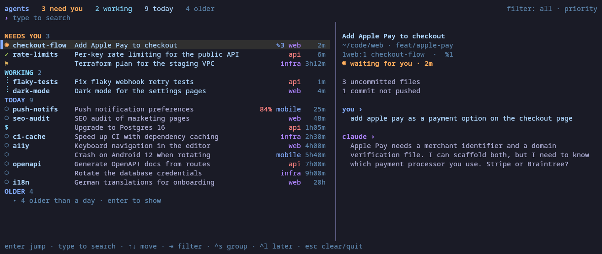

# tmux-ai-navigator

A picker for the AI coding agents running in your tmux panes. It's like
[herdr](https://herdr.dev)'s agent list, but for tmux. It shows every
[Claude Code](https://claude.com/claude-code) session in every tmux session and window,
grouped by what needs you: sessions **waiting** for an answer, ones that **finished since
you last looked**, and ones you flagged for **later**. Then come sessions that are working,
active today, and older ones. A preview shows each session's last prompt and reply. You can
search the list and press Enter to jump to that pane.



Try it without any sessions of your own: `bin/tmux-ai-nav demo`.

## Requirements

- Linux or macOS.
- tmux 3.0 or newer. The picker opens in a temporary window (a popup for tmux 3.2+ is
  planned).
- Python 3.8 or newer, standard library only.
- Claude Code. It writes a status file for each running session in `~/.claude/sessions/`,
  and that's where the list comes from.

## Install

With [TPM](https://github.com/tmux-plugins/tpm):

```tmux
set -g @plugin 'ferrants/tmux-ai-navigator'
```

Manually:

```sh
git clone https://github.com/ferrants/tmux-ai-navigator ~/.tmux/plugins/tmux-ai-navigator
```

```tmux
# ~/.tmux.conf
run-shell ~/.tmux/plugins/tmux-ai-navigator/tmux-ai-navigator.tmux
```

Then reload the config with `tmux source ~/.tmux.conf`.

Options (set them before the plugin loads):

```tmux
set -g @ainav-key 'a'                # prefix key that opens/closes the picker (default a)
set -g @ainav-later-key 'u'          # prefix key: flag the current pane's session for later (default u)
set -g @ainav-extras 'command'       # extras command, see below (default none)
set -g @ainav-extras-interval '5'    # seconds between extras runs (default 5)
```

## Use

`prefix a` opens the picker. Pressing it again inside the picker closes it.

Each row shows the tmux window name, Claude's title for the session, the project (the tmux
session name without a leading number, e.g. `2api` → `api`), and how long it has been in its
current state.

| icon | |
|---|---|
| ◉ | waiting for you (a question or permission prompt) |
| ✓ | finished since you last looked at its pane |
| ⚑ | flagged for later |
| ⠋ | working |
| $ | a background shell is running |
| ○ | idle |

| key | |
|---|---|
| type | search window name, title, project, path, branch, status and extras (all words must match; ignores case unless the search has a capital) |
| ↑ ↓ / ctrl-p ctrl-n, PgUp PgDn | move |
| enter | jump to that agent's pane (or expand "older") |
| tab / shift-tab | filter: all, needs you, working, idle |
| ctrl-s | group: priority sections, or by project |
| ctrl-l | flag or unflag the selected session for later |
| ctrl-u / ctrl-w | clear the search / delete the last word |
| esc | clear the search, or quit if it's empty |

`prefix u` flags the session in the current pane for later without opening the picker. A
flag clears once you prompt that session again.

The list refreshes every second. On wide terminals the preview sits on the right; on
narrow ones it goes underneath.

Colors follow Tokyo Night on 256-color terminals. Inside tmux, a plain `screen`/`tmux`
TERM is upgraded to its `-256color` variant for the picker, and tmux maps colors down for
clients that can't show them. On 8-color terminals it falls back to the basic ANSI colors.

From scripts: `tmux-ai-nav list [--json] [--all]`.

## Extras

An extras command adds your own information to the picker: a short badge on the row, a
title for sessions Claude hasn't titled well, lines in the preview, and extra search text.
Use it for whatever you track per session: notes, ticket numbers, git state, context usage.

```tmux
set -g @ainav-extras 'python3 ~/.tmux/plugins/tmux-ai-navigator/examples/git-status-extras.py'
```

The command gets the sessions as JSON on stdin:

```json
{"sessions": [{"session_id": "…", "pid": 4121, "cwd": "/home/me/code/api", "status": "idle",
               "pane_id": "%3", "tmux_session": "2api", "window_name": "rate-limits"}]}
```

and prints a JSON object keyed by session id. Every field is optional, and sessions can be
left out:

```json
{"<session_id>": {
    "badge": "✎3",
    "badge_style": "info",
    "title": "Per-key rate limiting",
    "lines": ["3 uncommitted files", "1 commit not pushed"],
    "search": "dirty"
}}
```

| field | |
|---|---|
| `badge` | up to 8 characters, shown before the project tag |
| `badge_style` | `warn` (red), `info` (accent) or `dim` (default) |
| `title` | used when Claude's own title is missing or is just an id or the repo name |
| `lines` | shown in the preview under the status line |
| `search` | extra text that search matches |

It runs at most every `@ainav-extras-interval` seconds, and right away when new sessions
appear, with a 3 second timeout. If it fails, the picker shows the error in its footer and
carries on. [`examples/git-status-extras.py`](examples/git-status-extras.py) is a complete
example. You can also pass `--extras 'command'` to `tmux-ai-nav`.

## How it works

- **Sessions.** Each `~/.claude/sessions/<pid>.json` holds the session id, name, working
  directory, status (`busy`, `idle`, `waiting`, `shell`) and when that status last
  changed. Files are left behind when Claude exits, so an entry only counts if its process
  is still running with the same start time (`/proc` on Linux, `ps` on macOS).
- **Finding the pane.** Each agent is matched to its pane by walking up its parent
  processes until one is a pane's shell (`#{pane_pid}`). The pane recorded in the session
  file goes stale when panes are moved, so it isn't used.
- **Jumping.** One `switch-client -c <client> -t '$session:@window.%pane'` switches the
  client that pressed the key to that session, window and pane. Naming the session handles
  windows linked into several sessions.
- **Done.** tmux hooks (`after-select-window`, `after-select-pane`, `client-session-changed`, …)
  run `tmux-ai-nav seen`, which records the panes on screen and the panes that just left it.
  A session is "done" when it went idle after real work, later than its pane was last seen.
  That state lives in `~/.local/state/tmux-ai-navigator/` and resets when the tmux server
  restarts. "Later" flags clear once the session's status changes after you flagged it,
  meaning you've prompted it again.
- **Titles and preview.** Claude's pane title is used first. When that title is just an id
  or the repo name, the latest title in the conversation log is used instead (offsets are
  cached in `~/.cache/tmux-ai-navigator/`). The preview reads only the end of the conversation
  log, and only for the selected row.

## Limitations

- The session files and conversation logs are Claude Code internals, not a documented
  interface. A Claude Code update can change them. Fields that are missing or have changed
  are skipped rather than crashing the picker, but sessions may stop showing up until this
  tool catches up.
- Closing a terminal window without detaching doesn't run tmux's detach hook, so a session
  that finishes while that window is gone may not show as done.
- Only Claude Code for now. Sessions that aren't inside tmux show up in `list --all` only.

## Uninstall

Remove the plugin line from `~/.tmux.conf`, then:

```sh
for h in after-select-pane after-select-window session-window-changed client-session-changed \
         client-attached client-detached; do tmux set-hook -gu "$h[87]"; done
tmux unbind a; tmux unbind u    # or your @ainav-key / @ainav-later-key
rm -rf ~/.local/state/tmux-ai-navigator ~/.cache/tmux-ai-navigator
```

## Development

```sh
python3 -m unittest discover -s tests   # unit tests + end-to-end tests on a private tmux server
bin/tmux-ai-nav list                    # run from the checkout
bin/tmux-ai-nav demo                    # the picker on made-up sessions
```

## Roadmap

- A popup on tmux 3.2+.
- Other agents (Codex, …).
- A preview of the end of each session's pane, and a status-line count.

## License

MIT
